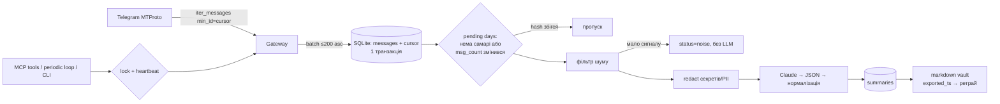

# Telegram → «другий мозок» (MCP-сервер)

MCP-сервер, який підключається до Telegram (DM + групи), дає агенту інструменти перегляду/відправки,
**інкрементально** синхронізує нові повідомлення і через LLM складає **короткі денні самарі** у markdown-vault.

**Що вирішує:** агент (Claude Desktop / Claude Code) за одну команду піднімає контекст робочих чатів
як структурований конспект (рішення, action items, відкриті питання), а не як сирий дамп переписки.

## MCP-інструменти
Сервер працює через stdio.

| Tool | Призначення |
|---|---|
| `list_chats` | Чати (DM, групи, канали), пошук за назвою, прапорець `sync_enabled` |
| `get_messages` | Сирий перегляд історії чату напряму з Telegram (≤100), **не** синхронізація |
| `send_message` | Відправка. **Вимкнено за замовчуванням** (`TG_ALLOW_SEND=1`) |
| `enable_sync` | Allowlist: які чати синхронізувати (за замовчуванням — жодного) |
| `sync_now` | Синхронізація за командою: лише нові повідомлення + самарі нових/змінених днів |
| `sync_status` | Курсори чатів, кількість повідомлень, останні запуски |
| `get_summaries` | Готові денні самарі з бази знань |

## Швидкий старт
Потрібно: Python 3.10+, `api_id`/`api_hash` з [my.telegram.org](https://my.telegram.org) (API development tools), ключ Anthropic.
Скрипти нижче перевірені для macOS/Linux; на Windows запускай ті самі команди з `.venv\Scripts\python`.

1. `git clone https://github.com/anastasiiauliankina/telegram-mcp-connector && cd telegram-mcp-connector`
2. `bash setup.sh` — створює `.venv`, ставить залежності, перевіряє ключі.
3. Відкрий `.env` і заповни `TG_API_ID`, `TG_API_HASH`, `ANTHROPIC_API_KEY`.
4. `bash auth.sh` — одноразова авторизація в Telegram (телефон, код, 2FA).
5. `.venv/bin/python -m tg_mcp.cli chats 2>/dev/null` — список чатів і їхні ID.
6. `bash scripts/demo.sh run1 <id1> <id2> <id3>` — перший прогін; `run2` з тими ж ID — повторний (0 нових, 0 дублів, 0 LLM-викликів).
   Назви та ID чатів у лозі маскуються автоматично.
7. `bash connect_claude.sh` (Claude Desktop, macOS) і перезапуск застосунку. Для Claude Code:
   `claude mcp add telegram -- "$(pwd)/.venv/bin/python" -m tg_mcp.server`.
8. Тести: `.venv/bin/python -m unittest discover -s tests -v`.

**Перевірити логіку без Telegram і ключів:** `python3 scripts/demo_offline.py` (фейковий Telegram + фейковий LLM, реальний код ядра).

## Потік даних

Три незалежні стадії, кожна ретраїться окремо при наступному запуску: **ingest** → **summarize** → **export**.
Збій LLM не блокує експорт уже готових самарі, збій експорту не викликає повторний LLM-запит.

### Lock, heartbeat і стадії (як це працює насправді)
| Крок | Що відбувається |
|---|---|
| Захоплення | `acquire_lock` у транзакції `BEGIN IMMEDIATE`: рядок `locks(name, owner=uuid, expires)`. Якщо lock чужий і не прострочений — запуск `skipped` (не черга). TTL **30 хв** (`Config.lock_ttl`, у `.env` не виноситься) |
| Heartbeat | `renew_lock` (`UPDATE … WHERE owner=?`) перед кожною пачкою ≤200 повідомлень, перед кожним днем самарі і **перед кожним Markdown-файлом**. Подовжує оренду; `rowcount=0` → `LockLost` |
| Атомарна перевірка | `ingest`, `save_summary`, `mark_exported` і скидання самарі при зміні версії промпта (`ensure_prompt_version`) перевіряють власника lock **у тій самій транзакції, що й запис**: навіть якщо lock забрали між heartbeat і записом, запис відхиляється |
| Втрата lock | Весь запуск зупиняється: інші чати не читаються, нові самарі й експорти не пишуться, у звіті `aborted: "lock lost"`, статус `partial`. `release_lock` видаляє лише власний рядок |

| Стадія | Ознака «зроблено» | Поведінка при збої |
|---|---|---|
| 1. **ingest** | `messages` + `chats.last_msg_id` в одній транзакції | Зберігається безперервний префікс; наступний запуск продовжує з курсора |
| 2. **summarize** | рядок у `summaries` (`input_hash`, `msg_count`) | День не записується, інші дні обробляються далі; ретрай наступного запуску |
| 3. **export** | `summaries.exported_ts IS NOT NULL` | Самарі лишається в SQLite з `exported_ts=NULL`; кожен запуск повторює експорт **без виклику LLM**. Перегенероване самарі (змінились повідомлення) скидає `exported_ts` і експортується знову. Файл пишеться через `.tmp` + `os.replace` |

## Рішення та обґрунтування
| Тема | Рішення | Чому |
|---|---|---|
| Доступ | Telethon, user-акаунт (MTProto) | Bot API не бачить DM користувача та історію груп |
| Дублі | PK `(chat_id,msg_id)` + `INSERT OR IGNORE` | Дубль фізично неможливий, навіть при ручному втручанні |
| Пропуски | Курсор `last_msg_id` на чат, оновлюється **в тій самій транзакції**, що й вставка; fetch віддає msg_id строго зростаючи | Краш не лишає «курсор попереду даних»; при збої зберігається безперервний префікс |
| Повторні/подвійні запуски | lock із TTL у SQLite (`BEGIN IMMEDIATE`) + **heartbeat** перед кожною пачкою/днем/експортом + **атомарна перевірка власника lock всередині кожної транзакції запису** (повідомлення, самарі, `exported_ts`) | Працює між процесами (cron + MCP-сервер); навіть якщо lock забрали між heartbeat і записом, запис відхиляється (`LockLost`); при втраті lock весь запуск зупиняється (інші чати не читаються, самарі й експорт не пишуться); другий запуск — skip, а не черга |
| Інкрементальність | `min_id=cursor`; перший раз — `BACKFILL_DAYS` | Telegram віддає лише нове; ліміт історії при онбордингу чату |
| Ідемпотентні самарі | PK `(chat_id,day)`, `input_hash` (з версією промпта), `msg_count` | LLM викликається лише для нових/змінених днів |
| Збій LLM | День не записується, **інші дні обробляються далі**, статус `partial`, ретрай при наступному запуску | Один поганий день не блокує решту історії |
| Незавершений день | Самарі лише за завершені дні (`include_today` — опційно) | Не палимо токени на частковий день; хеш перегенерує, якщо день змінився |
| Шум | Правила (тривіальні/емодзі/службові) → поріг змістовних повідомлень → LLM може повернути `relevant:false` | Дешево відсікаємо до LLM, а LLM не змушуємо вигадувати |
| Якість самарі | Структура: summary / decisions / action_items / open_questions / topics; map-reduce для довгих днів; **нормалізація JSON** після LLM | Короткий контекст замість дампу; «дивний» JSON моделі не ламає експорт |
| Секрети | `.env`, session `chmod 600`, allowlist чатів (opt-in), redact токенів/паролів/карт (Luhn)/email/телефонів **до** LLM, `send_message` вимкнено за замовчуванням | Мінімізація витоку; захист від випадкових дій агента |
| Prompt injection | Чат передається як `<chat>`-дані, повідомлення не можуть закрити тег, системна заборона виконувати інструкції з тексту | Чужі повідомлення — недовірений ввід |
| Сховище | SQLite (джерело правди) + markdown vault з валідним YAML front-matter; папка чату прив'язана до `chat_id` (перейменування чату не плодить копій) | Без зовнішніх залежностей, читабельно, імпортується в Notion/Obsidian |

## Trade-offs
* SQLite замість Postgres: простота й атомарність для одного користувача; не масштабується на багатьох.
* Markdown замість Notion API: менше точок відмови; Notion-синк додається як окремий sink поверх таблиці `summaries`.
* Опитування (polling) замість realtime-подій: простіше відновлення після пропусків; затримка = `SYNC_INTERVAL_MIN`.
* Зміна `PROMPT_VERSION` перегенерує **всі** самарі (це похідні дані) — дорожче, зате без «змішаних» версій.
* Сирі повідомлення зберігаються локально (потрібні для хешів/перегенерації); це чутливі дані → шифруй диск/бекапи.

## Обмеження
* Редагування та видалення старих повідомлень не підтягуються (курсор бачить лише нові id).
* Медіа/голосові не транскрибуються — лише текст і підписи.
* Redact — regex-евристика, не гарантія; імена учасників відправляються в LLM.
* **`get_messages` і `send_message` працюють з будь-яким чатом акаунта, а не лише з allowlist** (allowlist обмежує
  синхронізацію/самарі). Тому відправка вимкнена за замовчуванням; вмикай її лише коли довіряєш клієнту.
* TTL lock — 30 хв: після жорсткого краша наступний запуск можливий після спливу оренди. Heartbeat спрацьовує між кроками,
  а не під час одного довгого LLM-запиту; запис після втрати lock у цьому випадку все одно блокує перевірка власника в транзакції.
* Файл у vault записується до `mark_exported`: якщо lock втрачено саме між ними, самарі експортується повторно наступним запуском
  (запис ідемпотентний — перезапис того самого файлу).
* Одна Telethon-сесія = один процес: не запускай CLI одночасно з MCP-сервером (`database is locked`).
* Чати поза `dialogs_limit` (200) не видно для `enable_sync`; такі ID повертаються в звіті як `unknown_chat_ids`.
* Періодична синхронізація: перший прогін через ~15 с після старту сервера (доганяє все, що прийшло, поки він був
  вимкнений), далі кожні `SYNC_INTERVAL_MIN`. Працює лише поки запущений MCP-клієнт; для фону без клієнта — cron з `tg-mcp-cli sync`.
* Ядро (курсор, дедуплікація, lock, відновлення) покрите юніт-тестами на мок-даних; реальні Telethon/Anthropic-виклики
  перевірялись вручну (див. `docs/demo/`), але не в CI.

## Підключення до Claude Desktop (macOS)
`bash connect_claude.sh` сам додає сервер у `~/Library/Application Support/Claude/claude_desktop_config.json`
(з резервною копією) — далі Cmd+Q і відкрити Claude Desktop. Ключі й шляхи сервер бере з `.env` у корені проєкту.
Приклади запитів: «покажи мої чати», «синхронізуй чат <id>», «покажи самарі за вчора», «який статус синхронізації».
Періодична синхронізація працює всередині сервера (`SYNC_INTERVAL_MIN`), лише для чатів з allowlist.

## Демо
Результати наскрізного прогону на 3 реальних чатах (1 DM + 2 групи) з повторними прогонами — у [`docs/demo/`](docs/demo/README.md).

* `scripts/demo.sh run1 <ids>` → перший прогін, `run2 <ids>` → повторний (0 нових, 0 викликів LLM),
  `run3 <ids> --include-today` → після нових повідомлень у чаті. Логи — у `docs/demo/`. Кожен лог містить кількість
  LLM-викликів, `total`/`distinct` повідомлень (рівність = дублів немає), курсор і кількість збережених повідомлень по
  кожному чату, статуси самарі. Назви/ID чатів маскуються автоматично (`scripts/mask_log.py`).
* `scripts/demo_offline.py` → детермінований прогін без Telegram: перший/повторний запуск, +7 нових повідомлень,
  краш посеред читання та відновлення, одночасні запуски. Результат: `docs/demo/offline_demo.log`.

## Структура
`src/tg_mcp/`: `server.py` (MCP tools) · `sync.py` (ядро) · `db.py` (схема, транзакції, lock) · `telegram_client.py` ·
`summarizer.py` · `filtering.py` · `redact.py` · `export.py` · `cli.py` · `auth.py`  
`tests/`: курсор/дублі/краш/lock/шум (`test_sync.py`), ретрай експорту/міграція/втрата lock/версія промпта (`test_reliability.py`),
атомарність lock і зупинка запуску (`test_lock_guard.py`), redact/нормалізація/YAML/vault (`test_quality.py`),
реєстрація MCP-інструментів і заборона відправки за замовчуванням (`test_mcp_server.py`).
